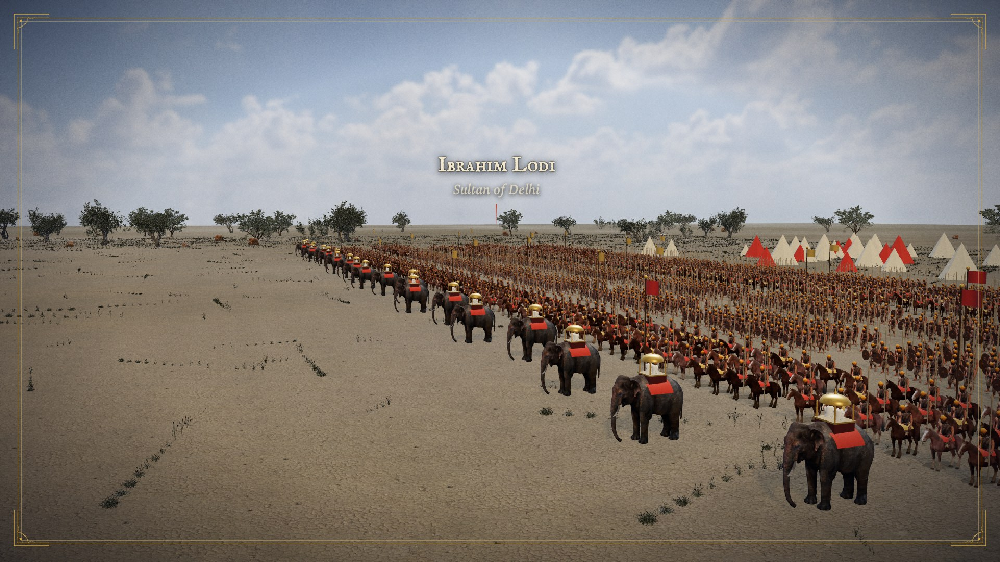
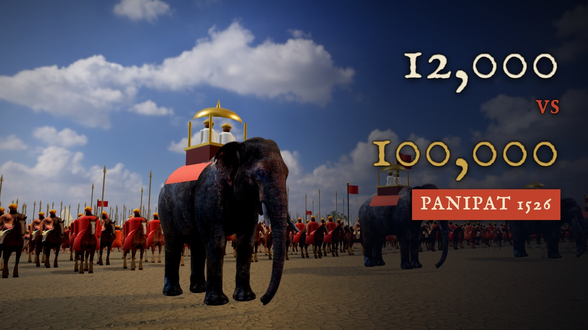
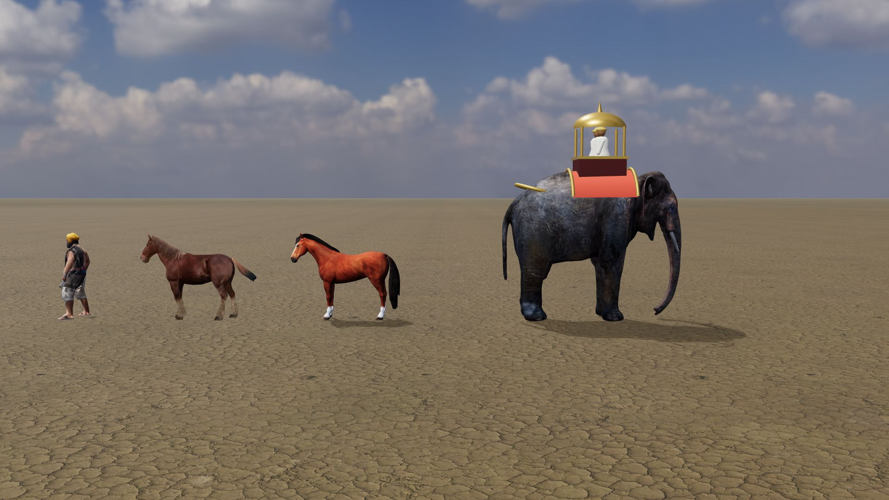

# Atlas of Time · YouTube history documentaries

A complete, reusable pipeline (and a Claude skill) for making narrated history documentaries for YouTube.
It covers sourced research, natural AI narration with correct pronunciation of non-English names, painted-album
maps and cards, **realistic 3D battle reconstructions with real elephant, horse and soldier models**, a music
mix, subtitles in several languages, A/B thumbnails and a full SEO and upload package.

The worked example is **The First Battle of Panipat (1526)**: 13 minutes 41 seconds, 10 chapters, built entirely
with free tools and openly licensed assets.

| Real models on photographic ground | Thumbnail | The models |
|---|---|---|
|  |  |  |

## Use it with Claude

The skill lives in [`skill/history-documentary/`](skill/history-documentary/SKILL.md): a step-by-step workflow
plus fifteen reference chapters (research, narration, visuals, 3D battles, licensing, rendering, subtitles,
thumbnails, YouTube SEO, troubleshooting, and a field-by-field guide to setting up the channel and uploading
through the browser, an originality and monetisation checklist, storytelling lessons from the best battle channels, and production lessons from the second film).

- **Claude Code**: copy the folder to `~/.claude/skills/history-documentary/` (or `.claude/skills/` in a project),
  then ask: *"Make a YouTube documentary about the Battle of Plassey using the history-documentary skill."*
- **Claude.ai**: zip the `history-documentary` folder and upload it under Settings → Capabilities → Skills.

## Use it by hand

```bash
# 1. Write examples/<topic>/script.json and lexicon.json (see references 01 and 02)
pip install kokoro-onnx soundfile numpy
python3 tools/narrate.py script.json --lexicon lexicon.json --out rec --voice af_heart --speed 0.95 \
    --model kokoro-v1.0.int8.onnx --voices voices-v1.0.bin
python3 tools/build_narration.py script.json rec/timings.json rec out/
cp out/timeline.json template/src/timeline.json

# 2. Assets: free Poly Haven sky, ground and plants; Sketchfab models you download with a free account
python3 tools/fetch_polyhaven.py template/public
tools/prepare_models.sh ~/Downloads template/public/sk

# 3. Adapt template/src/scenes/Visuals.tsx (one visual per beat), then render in chunks (reference 06)
cd template && NODE_ENV=development npm install --include=dev
npx remotion studio            # preview
# ... chunked render -> out/master.mp4

# 4. Mix, mux, subtitles, thumbnails
python3 tools/mix.py --timeline src/timeline.json --voice ../out/narration_raw.wav --music-dir music \
    --plan music_plan.json --out ../out/docmix.wav
python3 tools/mksrt.py --timeline template/src/timeline.json --timings rec/timings.json --out subtitles-en.srt --chapters chapters.txt
npx remotion still Thumb out/thumb0.jpg --props='{"v":0}' --gl=angle

# 5. Channel branding: profile picture, banner (safe-area guide) and transparent watermark
python3 tools/branding/banner.py --name "Atlas of Time" --tagline "BATTLES · EMPIRES · TURNING POINTS"
python3 tools/branding/render.py   # -> build/branding/*.png|jpg

# 6. Channel setup and upload: follow skill/history-documentary/references/11-channel-setup-and-browser-upload.md
```

## Repository layout

```
skill/history-documentary/      the Claude skill: SKILL.md + references/01..14
template/                       Remotion 4 project (React 19, three.js, @react-three/fiber)
  src/Video.tsx                 shots from timeline.json, crossfades, album-page frame
  src/scenes/Visuals.tsx        beat → visual switch, incl. battleShot() camera and state per beat
  src/scenes/Cards*.tsx         chapter cards, painting folios, quote cards, diagrams, end card
  src/map/                      map plate on real terrain, routes, cities, 2D battle plate
  src/battle/                   3D battle: Battle3D, real models, HDR environment, asset preloading
  src/scenes/Thumb.tsx          thumbnail compositions
tools/                          narrate.py, build_narration.py, mix.py, mksrt.py, fetch_polyhaven.py,
                                prepare_models.sh, mkterrain.py
tools/branding/                 profile.svg, watermark.svg, banner.py, render.py (channel art)
examples/panipat-1526/          script.json, lexicon.json (52 IPA names), hi.json (Hindi translation),
                                music_plan.json, pictures.json, description.txt, upload-guide.md
```

Heavy and third-party assets (HDRIs, textures, Sketchfab models, paintings, music) are **not** in the repo;
the scripts and `CREDITS.md` say where to get each one.

## Requirements

- macOS with Apple silicon (recommended; `--gl=angle` renders 3D on the GPU) or Linux with a GPU
- Node 20+, Python 3.10+, ffmpeg
- Optional: a Raspberry Pi 5 works fine for narration

## Licence

Code: MIT. Fonts: SIL OFL. Third-party assets keep their own licences; see [CREDITS.md](CREDITS.md).
